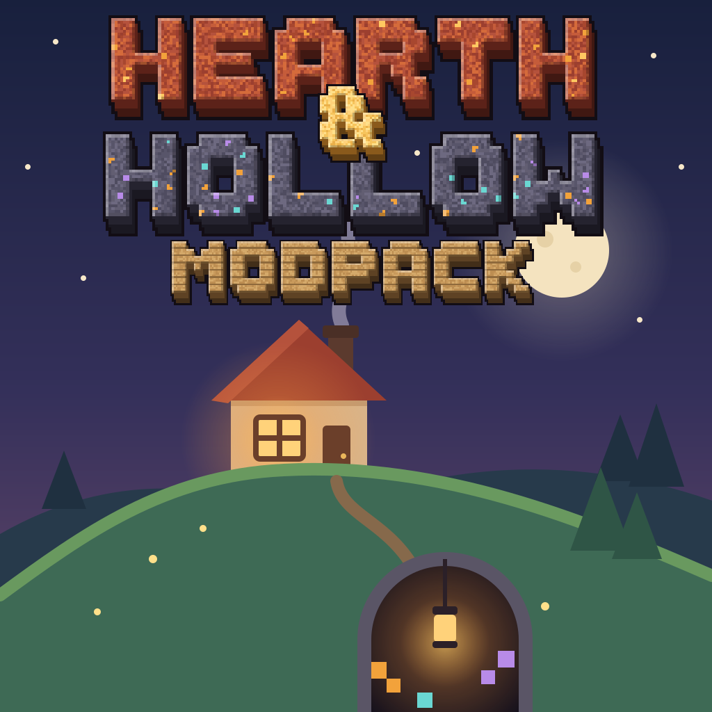

<p align="center"></p>

# Hearth & Hollow

A cozy-adjacent kitchen-sink modpack for Minecraft 1.21.1 (NeoForge): world, QoL, tech and building mods, tuned to run well. No magic.

Explore pretty biomes with friends, build a home worth coming back to, and duck into the mining dimension when you need ore. There's enough tech and automation to make a base hum, a guided quest book, and room for the people who just want to decorate. It's built to run on an average laptop (including a MacBook) or a Steam Deck, with shaders, under 6 GB of RAM.

## Inspiration

Hearth & Hollow is an independent pack. It is **not affiliated with, endorsed by, or made by** the All The Mods team or the Cozy Zen author. It was inspired by playing these packs, and its mod list started from theirs:

- [All the Mods 10 Lite](https://www.curseforge.com/minecraft/modpacks/all-the-mods-10-lite) and [All the Mods 10](https://www.curseforge.com/minecraft/modpacks/all-the-mods-10)
- [Cozy Zen](https://www.curseforge.com/minecraft/modpacks/cozy-zen)

No quests, scripts, configs or other assets from those packs are included. The quest book, recipes and configuration here are written for this pack.

## What's in it

- **Exploring:** Terralith biomes, Incendium's Nether, Nullscape's End, Moog's sky islands, YUNG's structures, Towns and Towers, Formations, Structory, Explorify, paragliders with heart containers and stamina, waystones and JourneyMap
- **Mining:** the Allthemodium mining, Other and Beyond dimensions, Mining Gadgets, Allthemodium gear, one set of ores from AllTheOres
- **Building:** Macaw's, Handcrafted, FramedBlocks, Supplementaries, Cluttered, Twigs, Building Gadgets
- **Tech:** Mekanism, Refined Storage, Powah, Flux Networks, Oritech resource nodes, Mystical Agriculture with Botany Pots, Pylons and Modular Routers
- **Cozy:** Farmer's Delight and Croptopia food, Comforts, Hourglass, Cooking for Blockheads, ambient sounds, auroras, falling leaves, fireflies and other small particle details
- **Shaders:** Complementary Reimagined and Unbound (with Euphoria Patches), BSL and MakeUp Ultra Fast are included and off by default
- **Controllers:** Controlify, for gamepads and the Steam Deck

## Requirements

- Minecraft 1.21.1 with NeoForge 21.1.259
- At least 4 GB of RAM allocated, 6 GB recommended (8 GB if you run a heavy shader)

Running a server for friends? See the [server guide](docs/server.md).

## Reporting problems

If the game crashes, the Crash Assistant window can upload your logs and open a [new issue](https://github.com/cosmicspork/hearth-and-hollow/issues/new). Please say what you were doing when it happened.

## Development

The pack is managed with [packwiz](https://packwiz.infra.link/). Mods are referenced by CurseForge project and file, never committed as jars. The pack's own content lives in `config/` and `kubejs/`.

Common tasks are in the `justfile` (run `just` to list them):

```bash
just build    # build the client and server zips into dist/
just sync     # update your Prism instance in place, no reimport
just play     # sync, then launch it
just server   # update the local server in run/server and start it
just boot     # build the server pack and boot it once, as CI does
just update   # update every mod to its newest file
```

`just sync` updates the Prism instance `Hearth & Hollow (dev)`, creating it the first time, so the working copy never touches a `Hearth & Hollow` you installed from CurseForge to play. Local builds show the version `dev` on the title screen. Set `HH_INSTANCE` for another instance name, `PRISM_DIR` for a non-Flatpak install, and `just sync --dry-run` to see the changes first. It replaces the instance's mods, config and kubejs files with the pack's and leaves saves, options and keybinds alone.

## License

The pack's own files (quests, scripts, configs, artwork) are released under the [MIT License](LICENSE). Every mod belongs to its authors and is downloaded from CurseForge under its own license.
